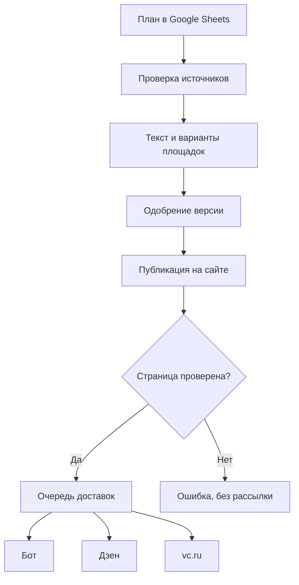

# Архитектура редакции и многоканальной публикации

Дата решения: 19.11.2026. Статус: архитектура и контракты зафиксированы; внешние адаптеры ещё не подключены. Сайт первоисточник, таблица живая очередь, GitHub хранит версии/источники/согласования. Не выдавать этот проект архитектуры за развёрнутую автоматическую доставку.

## Поток и границы

Планировщики уже созданы: исследование по вторникам/пятницам и подготовка HTML на согласование по средам/субботам, около 10:00 МСК. Они читают лист "Статьи", соблюдают исследование перед написанием и не публикуют без решения владельца. Автозадача не является надёжным транспортом между чатами или серверным webhook.

## Источники правды

| Данные | Где храним | Правило |
|---|---|---|
| Живое расписание, темы и рабочие статусы | Google Sheets, лист Статьи, sheetId 1168447911 | Поиск строки по стабильному ID, не по номеру строки |
| Снимок плана | editorial/articles/plan-2026.json | Резерв, не перезаписывает более свежую таблицу |
| Текст, медиа, исследование, варианты | drafts/<article-id>/ | Не попадает в публичный articles/ |
| Публикуемый источник | content/articles/<slug>.md и проверенный media manifest | Один текст, форматные адаптации |
| Согласование | approvals/<article-id>/<version>.json | Привязано к версии и хешам комплекта |
| Доставки и подтверждения | VPS, отдельная постоянная БД | Не в публичной папке сайта |

Существующий пример со slug-папкой остаётся на месте; для новой очереди используем стабильные VA26-xxx. Slug URL может меняться до публикации, ID не меняется.

## Исследование как обязательный этап

Переходы: planned → researching → research_complete → drafting → review → approved → scheduled → published. Отдельно blocked и needs_revision.

research.md включает: вопрос читателя, аудиторию и страны, источники с фактической датой чтения/обновления, утверждение → источник, практическую проверку, различия вариантов языка, ограничения и неизвестные. Один статус "Проверено" в таблице без исследования в GitHub не открывает публикацию.

Рабочие пороги свежести: новости/афиша/дедлайны перепроверяются в день выпуска; правила въезда/платежей и условия сервисов тоже перед выпуском; остальные практические инструкции не старше 7 дней при одобрении. Это наши редакционные пороги, не внешняя гарантия актуальности. Перенос новостной статьи означает повторную проверку.

## Как "ок" запускает публикацию

Алик видит полный HTML и варианты внешних площадок. Агент обрабатывает явное одобрение конкретного комплекта, сохраняет approval-event с ID, хешем текста, медиаманифеста и каждой версии площадки, временем, автором решения и ссылкой на контекст. Текст самого чата сервер автоматически не читает. Если "ок" сказано здесь, текущий автор фиксирует событие в GitHub; если в панели владельца, сервер формирует то же событие.

Поддельный/случайный commit не должен обходить согласование: публикационный workflow принимает только approval от подтверждённого владельца/разрешённого app, проверяет разрешения репозитория и контрольный manifest. Ключи и подпись события при серверном маршруте остаются в Secrets/VPS. Публичный approval JSON без проверки происхождения не является достаточным разрешением.

Далее workflow на approval commit или проверенный серверный event: проверить исследование/хеши/права → production-build → сайт → health-check конкретной страницы → статья опубликована → создать отдельные задания бот/Дзен/vc.ru. Изменение содержимого после одобрения аннулирует approval; адаптер может менять формат, но не добавлять новые утверждения. Утверждённое оформление не является одобрением любого текста.

До подключения адаптеров агент может сформировать одобренный пакет, но состояние доставки blocked_config, а не "отправлено".

## Очередь и защита от дублей

На VPS предлагаем SQLite в отдельном постоянном каталоге редакции, не в каталоге релизов. Для небольшого объёма отдельный брокер не нужен. Worker systemd с повторным запуском после ошибок. Предложение не установлено на сервер.

Ключ уникальности доставки: article_id + approved_version + channel. Таблица deliveries: status, attempts, next_attempt_at, remote_id, remote_url, content_hash, last_error, last_checked_at. Использовать атомарную постановку и lease задания.

Состояния: blocked_config, queued, in_progress, submitted, published, failed, skipped. "submitted" не равен "published": для RSS это только появление в ленте. При неизвестном результате сначала сверить remote_id/площадку, не слать ещё одну копию. Повторный запуск после сбоя сайта продолжает только недоставленные каналы; сбой одного адаптера не откатывает опубликованную статью.

Новая версия обновляет существующий материал, если площадка разрешает, а не создаёт ещё один пост. Для рассылки исправлений существенных фактов нужно согласование. Полное удаление/отзыв и повторный выпуск тоже фиксируются явно.

## Адаптеры и ограничения площадок

| Канал | Планируемый маршрут | Что нужно до включения | Состояние сейчас |
|---|---|---|---|
| Сайт Вернатуна | GitHub → существующий build/deploy → проверка страницы | Перенос одобренного дизайна и медиа, production-build, правильный sitemap, approval trigger | Исходный deploy есть, новый редакционный автомат ещё не внедрён |
| Бот | Серверный outbox → подтверждённый обработчик бота → receipt | Сверить текущий Nighttech1/Vernatun-Bot-Base, формат запроса, авторизацию и подтверждение | Не подключён в этой задаче |
| Дзен | Отдельный адаптер RSS, если доступен и разрешён конкретному каналу; иначе согласованный редакторский маршрут | URL канала, владелец/редактор, проверка актуальных условий импорта в кабинете, разрешённый тест | Документация RSS не открылась; поддержка и условия для аккаунта не подтверждены |
| vc.ru | Разрешённый площадкой способ публикации/авторизованный редактор; API только после получения подтверждённой спецификации и доступа | URL блога, статус коммерческого аккаунта и Pro, права редактора, лимиты, допустимая тематика | Публичный API публикации по первичной документации не подтверждён, адаптер выключен |

Нельзя использовать недокументированный API с выдуманными endpoint или скрыто переносить cookies в скрипт. Браузерный маршрут возможен при явно разрешённом подключении и соблюдении правил, но нестабилен при изменениях редактора и не считается готовой полностью автоматической интеграцией. CAPTCHA/2FA требует участия владельца, очередь сохраняется.

По официальной справке vc.ru коммерческие аккаунты без Pro имеют лимит один опубликованный пост в месяц и ограничение внутренней дистрибуции. Две публикации в неделю туда обещать нельзя без проверки статуса. Pro автоматически не покупаем. Технологические и образовательные темы вероятнее соответствуют аудитории vc.ru; это наша редакционная оценка, не гарантия модерации. Неподходящие темы остаются на сайте/Дзене, либо выбирается другая согласованная площадка.

Собственный текст разрешено переносить с другого сайта по текущим правилам vc.ru, но повторное размещение копий внутри платформы ради поднятия запрещено. Для рекламного контента отдельно проверять текущие правила. Ссылку на наш первоисточник добавляем там, где это уместно и разрешено.

## Форматы и SEO

В комплекте: article.md, research.md, media.json, review.html, manifest.json, channels/dzen.html, channels/vc.md, channels/bot.json. Все содержательные варианты показываем вместе; одно согласование относится к конкретным хешам комплекта.

Сначала сайт с canonical на себя. Внешние версии ссылаются на оригинал и используют оригинальный canonical только если площадка его поддерживает. Не обещать, что поисковик выберет наш URL: первенство по времени и ссылка не являются гарантией. Отдельные title/lead допустимы в рамках одобренного комплекта. Заголовки не кликбейтные.

Изображения с публичными устойчивыми HTTPS URL, проверенными правами. Data URI из offline-HTML не переносить в RSS. Ссылки, подписи и доступность медиа проверяются отдельно в каждом канале. Неподдерживаемую интерактивность чек-листа переводим в текст; видео в разрешённый embed или ссылку, без скрытой потери смысла.

## Запись результата в таблицу

Обновлять конкретную строку по ID после свежего чтения. Только свои поля: исследование, проверено на дату, статья, версия, URL сайта, статусы каналов. Не затирать согласование владельца. Включить взаимное исключение или условное сравнение версии для защиты от одновременного редактирования. Статус в таблице является отражением журналов, а не единственным источником разрешения.

Для запуска серверного синхронизатора нужен сервисный аккаунт с доступом только к нужной таблице, либо существующий подтверждённый безопасный доступ бота. Текущий доступ коннектора позволил заполнить таблицу, но не доказывает наличие серверных Google credentials.

## План внедрения

- [x] Заполнить таблицу и резервный календарь до 30.12.2026.
- [x] Настроить исследовательский и авторский запуски с единым ID.
- [x] Зафиксировать рубрики/теги и добавить вывод в исходный генератор.
- [ ] Перенести одобренный HTML-дизайн/медиа в генератор и закрыть пункты INTEGRATION.md.
- [ ] Реализовать валидатор manifest/approval, workflow и health-check страницы.
- [ ] Реализовать durable outbox, worker и синхронизацию статусов.
- [ ] Проверить и подключить бота по его фактическому контракту.
- [ ] Получить URL/доступы к внешним каналам, проверить тарифы/условия, выбрать доступные адаптеры.
- [ ] Проверить одну одобренную статью по всему пути и повторный запуск без дублей.
- [ ] Включить постоянную доставку только после успешной проверки; показать реальные URL/receipt.

## Проверка источников по площадкам, 19.11.2026

- https://vc.ru/rules , текущие правила, разделы о рекламе, повторных публикациях и копировании.
- https://vc.ru/support , ограничения коммерческих аккаунтов, редактор и медиа.
- https://vc.ru/about , описание аудитории.
- https://dzen.ru/help/ru/news/seamless/rss.html , попытка открытия неуспешна. Условия RSS по вторичным статьям не приняты за проверенную спецификацию.

Не оформлять новости о новых возможностях платформы по одному стороннему плагину.
