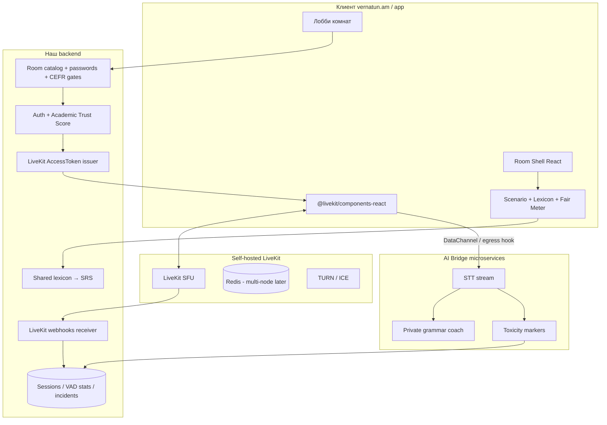

# Архитектура раздела «Голосовые комнаты Вернатун»

Документ опирается на исследование [`Анализ конкурентов языковых комнат.md`](./Анализ%20конкурентов%20языковых%20комнат.md) и продуктовую задумку «Vernatun Lounge» из `tasks/Vernatun forum.md`.

**Статус:** спецификация до кода. Реализации LiveKit / WebRTC в репозитории пока нет.  
**Канон стека:** self-hosted **LiveKit Server (SFU, Apache 2.0)** + нативный веб-клиент на своём домене.  
**Запрещено как основа продукта:** Discord embed, HelloTalk/Tandem API, Twilio/Agora как основной CPaaS (дорого и вендор-лок).

---

## 1. Зачем свой узел, а не чужой сервис

| Альтернатива | Почему не берём |
|--------------|-----------------|
| HelloTalk / Tandem | Закрытые экосистемы, нет SDK для встраивания; дейтинг-смещение и токсичность |
| Discord Stage | Нельзя прокинуть аудио на наш сайт; теряем бренд, телеметрию и LMS |
| Twilio / Agora | Поминутная тарификация → при 5 комнатах × 8 чел × 3 ч/день ≈ 216k участнико-минут/мес и тысячи $/год только за аудио |
| LiveKit Cloud как единственный путь | Допустимо на пилоте; цель — **self-hosted** на VPS с фиксированной арендой |

**Продуктовое отличие Вернатуна:** аудио — канал связи; визуальный фокус — дидактика (карточки CEFR, общий словарь → SRS, баланс речи, приватный AI-разбор), а не «ещё один Clubhouse».

---

## 2. Границы системы

### В зоне раздела (MVP → V1)

- Каталог комнат (открытые / по паролю / по уровню CEFR).
- Вход по JWT LiveKit; **несколько участников говорят одновременно** (как Discord Voice / TeamSpeak) и **все слышат всех** через SFU.
- Аудио-only SFU (видео вне scope V1).
- Mute по умолчанию при входе (антиспам); после unmute — полноценный multi-party разговор без «очереди одного спикера».
- Host/moderator: mute/kick; опциональный учебный режим «сцена» — позже (P2), не default.
- Синхронные дидактические поверхности (карточки, лексика, метр баланса).
- Сессионная телеметрия в наш backend (кто был, сколько говорил, события модерации).
- Связка с академическим профилем (язык, уровень, Trust Score).

### Вне зоны (явно позже)

- Полноценный форум / мем-хаб / карта диаспоры.
- Видео, screen share, SIP/телефония.
- Запись эфира на диск без отдельного юридического ТЗ.
- Дейтинг-фичи (гео, пол, крупные фото, ЛС между незнакомцами).

---

## 3. Логическая схема

---

## 4. Слои и ответственность

| Слой | Технология (целевая) | Ответственность |
|------|----------------------|-----------------|
| **Landing / маркетинг** | Текущий static HTML + Alpine | Ссылка в раздел Lounge; не держит WebRTC |
| **Lounge SPA** | React + `@livekit/components-react` | Лобби, комната, mute/unmute, список говорящих (multi-party) |
| **API** | Backend (FastAPI или существующий API-контур проекта) | Каталог комнат, пароли, CEFR-gate, Trust Score, выдача токенов, webhooks |
| **Медиа** | LiveKit Server self-hosted + TURN | Маршрутизация Opus RTP (SFU), комнаты, участники |
| **Данные сессий** | SQLite/Postgres (по спеке Backend) | Участие, VAD-минуты, инциденты, lexicon events |
| **SRS / лексика** | Существующий или новый модуль профиля | «В один клик в SRS» из Shared Room Lexicon |
| **AI** | AI Bridge | Приватный пост-репличный разбор; токсичность; без публичного шейминга |

**Важно для Vernatun сегодня:** сайт — static HTML. Голосовой раздел — **отдельное приложение** (поддомен `lounge.` или путь `/lounge`), встроенное в бренд, а не iframe Discord.

---

## 5. Модель комнаты и ролей

### Канон аудио: multi-party (Discord Voice / TeamSpeak)

**Не Stage-only.** В комнате могут **одновременно** говорить сколько угодно участников с включённым микрофоном; LiveKit SFU пересылает их Opus-треки всем подписчикам — **каждый слышит каждого**.

Это сознательный отказ от модели «один спикер на сцене / остальные только слушают» (Discord Stage / Clubhouse). Открытые и клубные комнаты Вернатуна ведут себя как голосовой канал TeamSpeak: перебивать можно, говорить хором можно, баланс речи показывает Fair Meter (не блокирует микрофон).

| Роль | Микрофон | Права |
|------|----------|--------|
| `member` | off при входе; **unmute → говорит параллельно с другими** | Слышит всех; публикует свой аудио-трек; клик в lexicon |
| `host` / `moderator` | как member + | Mute/kick других, пароль комнаты, Scenario Deck |
| `system` | — | Сервисные агенты (AI, toxicity) |

Вход: `canSubscribe=true`, `canPublish=true` для доверенных member (после auth/gate); микрофон в UI выключен до жеста пользователя.  
**Не** требуем «поднять руку», чтобы начать говорить в default-комнатах.

Опционально позже (P2): режим `classroom_stage` с рукой и promote — только для отдельных CEFR-уроков, не ломает multi-speak default.

### Типы комнат

1. **Открытая клубная** — как TeamSpeak: пароль опционален, **одновременная речь**, без дейтинг-UI.
2. **Учебная CEFR** — вход при подтверждённом уровне (A1…C1) + Trust Score ≥ порога; речь всё равно multi-party.
3. **Партнёрская по договорённости** — пароль из ветки форума (форум — соседний продукт; API комнат готов раньше форума).

---

## 6. Дидактический контур (продуктовое ядро)

| Механика | Источник данных | UX |
|----------|-----------------|-----|
| **Scenario Decks** | Backend + контент CEFR | Общая «доска» сценария, таймер реплик, задачи спикера |
| **Shared Room Lexicon** | LiveKit DataChannel + API | Клик → карточка слова → у всех на доске → «в мой SRS» |
| **Fair Speaking Meter** | LiveKit VAD / speaking events | Круговая доля времени говорения |
| **Private AI Coach** | STT → LLM | Только у автора реплики: грамматика, идиомы, слова-паразиты |

Дидактика **синхронизируется отдельно от RTP** (DataChannel / наш WebSocket), чтобы SFU оставался тонким.

---

## 7. Безопасность и академическая чистота (4 уровня)

1. **UI-политика:** нет гео «рядом», фильтра по полу, крупных фото для дейтинга, ЛС между незнакомцами вне комнаты. Профиль = язык, уровень, темы, бейджи.
2. **Mute-by-default + host mute/kick** (антиспам без запрета одновременной речи).
3. **Academic Trust Score:** тест уровня + жалобы модераторов снижают доступ к B2/C1.
4. **Потоковые маркеры токсичности** → авто-mute + тикет дежурному (не публичный разбор).

Токены LiveKit короткоживущие; секреты API только на сервере; TURN не светит ключи в клиент.

---

## 8. Инфраструктура и ёмкость (ориентиры из исследования)

- Кодек: **Opus** ~24–48 кбит/с; с VAD паузы почти не грузят канал.
- Комната 8 чел, **несколько одновременных говорящих** (типично 2–4): входящих потоков столько, сколько unmute; SFU фанаутит каждому подписчику. Ориентир порядка **0.5–2 Мбит/с** на активную комнату при 4 говорящих (не «один спикер → 350 кбит/с» как единственный сценарий).
- Старт: VPS 2–4 vCPU, 1 Гбит/с NIC (Hetzner-класс) — сотни аудиокомнат по нагрузке SFU; узкое место чаще NAT/TURN и продукт, не CPU.
- Redis — при горизонтальном масштабе LiveKit (не обязателен на пилоте одной ноды).
- Мониторинг: Prometheus metrics LiveKit + webhook → наша БД + дашборд (livekit-monitor / Grafana).

**Пилотная экономика:** фиксированная аренда VPS вместо $0.004/мин CPaaS.

---

## 9. Контракты API (черновик)

| Endpoint | Назначение |
|----------|------------|
| `GET /api/lounge/rooms` | Каталог: язык, CEFR, online count, locked |
| `POST /api/lounge/rooms` | Создать (host); пароль hash |
| `POST /api/lounge/rooms/{id}/token` | После auth + gate → LiveKit JWT (`canPublish` + `canSubscribe` для member) |
| `POST /api/lounge/rooms/{id}/mute` | Host глушит участника (не «очередь на сцену») |
| `POST /api/lounge/lexicon` | Добавить термин в комнату / в SRS юзера |
| `POST /api/lounge/webhooks/livekit` | room_started, participant_*, track_* |
| `GET /api/lounge/sessions/me` | История практики для ЛК |

Поля токена: `identity`, `name`, `room`, `canPublish`, `canSubscribe`, metadata `{ role, cefr, trust }`.

---

## 10. Цепочки ролей команды (chain)

### Инфра + медиа-скелет

`Архитектор → Backend (token + rooms) → Deployer (LiveKit+TURN) → Frontend (React lobby/room) → Тестировщик → Фиксер → Деплоер localhost → Клиент`

### Дидактика + AI

`Архитектор → AI Bridge (STT/coach/toxicity) → Backend (webhooks, lexicon, SRS) → Frontend → Motion (лёгкий UI meter) → Тестировщик → Фиксер → Клиент`

### Эксплуатация (после prod)

`Deployer + Realtime Ops skill` → алерты → при инциденте Фиксер/Backend; Клиент не блокирует hotfix P0 медиа.

Скилл-роутер: `.cursor/skills/livekit-voice-rooms/SKILL.md`.

---

## 11. Acceptance (языком Клиента)

Раздел принят, если на **desktop 1440** и **mobile iPhone/Android**:

1. Пользователь видит список комнат на нашем домене, без ухода в Discord.
2. Вход в комнату с mic off; после unmute **несколько человек говорят сразу** и **слышат друг друга** (как TeamSpeak).
3. Ведущий открывает Scenario Deck; слово из lexicon появляется у всех и уходит в «мой словарь».
4. Fair Meter отражает, кто говорил дольше (не запрещает параллельную речь).
5. Нарушитель правил глушится host’ом / авто-mute без превращения UI в дейтинг-ленту.
6. Нет горизонтального скролла страницы; CTA «в комнату» доступен пальцем; микрофон запрашивается осознанно (жест пользователя).

---

## 12. Риски и митигация

| Риск | Митигация |
|------|-----------|
| WebRTC за корпоративным NAT | TURN на том же VPS / отдельный coturn |
| Браузерный autoplay / mic policy | Кнопка «Войти с микрофоном» только по user gesture |
| Токсичность как у HelloTalk | 4 уровня защиты + Trust Score с первого дня |
| Раздувание scope (форум+карта+мемы) | Lounge V1 изолирован; форум — соседний epic |
| Утечка секретов LiveKit | Issuer только backend; rotate keys в runbook Deployer |
| Регрессии медиа без e2e | Ручной dual-browser тест + метрики SFU; Playwright не заменяет два реальных пира |

---

## 13. Готовность команды агентов (шкала)

| Уровень | Когда | Что покрыто |
|---------|--------|-------------|
| **L1 — проектирование** | Сейчас (после усиления skills/MCP/роли Realtime) | Spec, chain, экономика LiveKit, антипаттерны конкурентов, волны W1–W5 |
| **L2 — пилот пользователям** | Фазы 0–5 плана + вердикт Клиента без P0/P1 | SFU+TURN, токены, сцена/зал, дидактика V1, safety |
| **L3 — полная эксплуатация** | Фаза 7 + runtime ops MCP + алерты + AI opt-out + runbook | Все дневные сценарии разработки **и** дежурства: ICE/TURN инциденты, kick/mute audit, нагрузка, ротация ключей |

«Всевозможные» сценарии соседних epic’ов (форум, карта диаспоры, мемы) **не** входят в L3 Lounge — для них отдельные агенты/скиллы по мере запуска.

## 14. Связанные файлы

| Файл | Роль |
|------|------|
| [`DEVELOPMENT_PLAN.md`](./DEVELOPMENT_PLAN.md) | Пошаговый план с чекбоксами |
| [`Анализ конкурентов языковых комнат.md`](./Анализ%20конкурентов%20языковых%20комнат.md) | Исследование и экономика |
| `docs/TEAM_STRENGTH.md` | Усиление агентов под realtime |
| `.cursor/skills/livekit-voice-rooms/SKILL.md` | Skill-роутер раздела |
| `.cursor/registry/agents.md` | Роли и MCP |
| `knowledge/area_vernatun_lounge/_index.md` | Домен знания |

---

`🏗️ **АРХИТЕКТОР:** канон — self-hosted LiveKit SFU + **multi-party одновременная речь** (Discord Voice / TeamSpeak) + React Lounge + дидактика/безопасность; Stage-очередь не default; CPaaS и Discord embed отложены. План — `liverooms/DEVELOPMENT_PLAN.md`. Волна W-32: фазы 0–1.`
